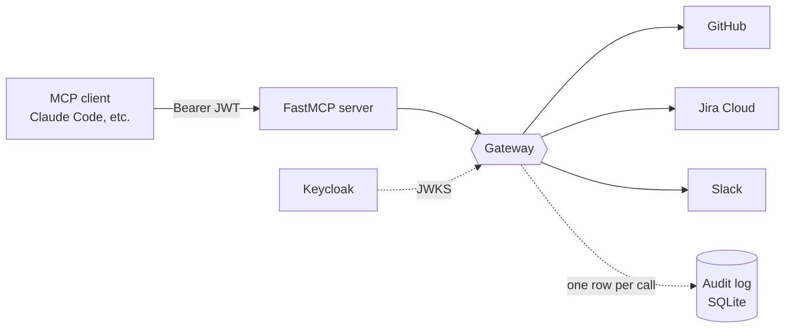

<div align="center">

# mcp-hub

**A permissioned gateway that lets AI assistants use GitHub, Jira and Slack, and only do what the user's role allows.**

[](https://github.com/SAKET-SAURABH-07/MCP-hub/actions/workflows/ci.yml)


[**Live demo & dashboard**](https://saket-saurabh-07.github.io/MCP-hub/) · [Threat model](docs/THREAT_MODEL.md) · [Role matrix](docs/RBAC.md)

</div>

---

## Why this exists

Connect an AI assistant to your company's tools and it inherits whatever the connecting credential can do. One leaked token, one prompt-injected instruction, and the model can write to places it should never touch.

**mcp-hub** puts one choke point between the assistant and your tools. Every call is authenticated, checked against the caller's role, checked against an allowlist of approved targets, validated, and written to an audit log, whether it succeeds or is refused.

> A prompt-injected model can do at most what the user's role and the server's allowlists permit.

## At a glance

| | |
|---|---|
| **Tools** | 9 across GitHub, Jira Cloud and Slack |
| **Identity** | Keycloak OIDC; RS256/ES256 JWTs verified against a cached JWKS |
| **Authorization** | Deny-by-default RBAC (viewer, developer, admin) plus server-side scope allowlists that bind admins too |
| **Reliability** | Per-caller rate limiting, idempotent writes, upstream retry with backoff |
| **Observability** | One redacted audit row per call, passed or refused; static dashboard over an exported snapshot |
| **Quality** | 139 tests at 98% coverage (85% enforced), 50 offline security evals, mypy and ruff in CI |

## Architecture



### The request pipeline

All nine tools are thin wrappers over a single gateway function. A request moves through the checks in this order and stops at the first one that refuses it. Whatever happens, one redacted audit row is written.

| # | Stage | What it enforces | Refusal code |
|:-:|---|---|---|
| 1 | **Authenticate** | Signature, `exp`, `iss`, `aud`, `sub` on the Keycloak JWT | `UNAUTHENTICATED` |
| 2 | **Rate limit** | Per-caller token bucket | `RATE_LIMITED` |
| 3 | **Authorize** | The caller's role must list the tool; unknown roles grant nothing | `FORBIDDEN` |
| 4 | **Validate** | Strict schemas; no `../` in identifiers, no raw JQL | `INVALID_ARGUMENTS` |
| 5 | **Idempotency** | Writes reserve a key; same key and arguments replay the stored result | `IDEMPOTENCY_KEY_REUSED` |
| 6 | **Scope** | Repo, project or channel must be on the allowlist, even for admins | `OUT_OF_SCOPE` |
| 7 | **Upstream** | GitHub, Jira or Slack call with retry and backoff | `UPSTREAM_ERROR` |
| 8 | **Audit** | Arguments redacted, then one row written | n/a |

**Why the order matters.** Authorization runs before validation, so a caller cannot probe the argument schema of a tool they are not allowed to use. Unexpected exceptions never reach the client: it receives `INTERNAL`, and the detail goes only to the audit log.

## Permissions

| Tool | viewer | developer | admin |
|---|:-:|:-:|:-:|
| `github_list_issues` | ✅ | ✅ | ✅ |
| `github_get_pull_request` | ✅ | ✅ | ✅ |
| `jira_search_issues` | ✅ | ✅ | ✅ |
| `slack_list_channels` | ✅ | ✅ | ✅ |
| `github_create_issue` | ❌ | ✅ | ✅ |
| `jira_create_issue` | ❌ | ✅ | ✅ |
| `jira_transition_issue` | ❌ | ✅ | ✅ |
| `slack_post_message` | ❌ | ✅ | ✅ |
| `bulk_create_issues_from_csv` (dry-run by default) | ❌ | ❌ | ✅ |

Roles come from the token's `realm_access.roles`; only known roles are kept. Each caller also **sees only their own tools** in `tools/list`. The matrix in [docs/RBAC.md](docs/RBAC.md) is generated from `rbac.py` and checked by a test, so docs and code cannot drift.

## Security design

| Threat | Control |
|---|---|
| Forged or expired token | RS256/ES256 only; `exp`, `iss`, `aud`, `sub` required; JWKS cached with rate-limited refetch |
| Over-privileged caller | Deny-by-default RBAC; tools hidden from roles that cannot use them |
| Model pointed at the wrong target | Server-side allowlists for repos, Jira projects and Slack channels; empty by default, so nothing is allowed until configured |
| Path traversal and query injection | Strict identifier patterns; Jira search is structured and the server builds escaped JQL |
| Secrets in logs | Redactor on key names and token shapes (GitHub, Slack, Atlassian, JWT, Bearer/Basic, AWS) before every audit write |
| Information leakage | Unexpected exceptions map to `INTERNAL`; stack traces stay server-side |
| Duplicate writes on retry | Idempotency keys with `absent → pending → done` state |
| Bulk misuse | Admin-only, dry-run by default |

Full analysis, including accepted risks, in [docs/THREAT_MODEL.md](docs/THREAT_MODEL.md).

## Quick start

Requires Python 3.12 and Docker (Docker only for the login server).

```bash
git clone https://github.com/SAKET-SAURABH-07/MCP-hub.git && cd MCP-hub
python3.12 -m venv .venv && source .venv/bin/activate   # Windows: .venv\Scripts\activate
pip install -e ".[dev,dashboard]"
```

### 1. Verify with no accounts

```bash
pytest                          # 139 tests
python evals/run_evals.py       # offline security evals
python scripts/e2e_local.py     # real server + fake token issuer
```

`e2e_local.py` checks role-filtered tool lists, denials, and rejection of missing or forged tokens, without any real service.

### 2. Run it against your own sandbox

```bash
cp .env.example .env            # add tokens; allowlist the sandbox ONLY
docker compose up -d            # Keycloak on :8080, realm "mcp-hub"
mcp-hub --transport http --port 8000
```

Demo users (development only, in `keycloak/realm-mcp-hub.json`): `alice` is a viewer, `bob` a developer, `carol` an admin.

### 3. Connect Claude

```bash
claude mcp add --transport http mcp-hub http://localhost:8000/mcp \
  --header "Authorization: Bearer $(python scripts/get_token.py bob)"
```

Tokens last 15 minutes; re-run to refresh. Ask Claude to list issues in your sandbox repo (works). Re-add the server with alice's token and ask it to create one (refused). Ask about a repo outside the allowlist (refused for everyone). Each attempt appears in the audit log.

## Configuration

All settings are `MCPHUB_*` environment variables; see `.env.example`.

| Variable | Purpose |
|---|---|
| `MCPHUB_GITHUB_TOKEN` | Fine-grained token: Issues read/write, Pull requests read, on the sandbox repo only |
| `MCPHUB_JIRA_BASE_URL`, `MCPHUB_JIRA_EMAIL`, `MCPHUB_JIRA_API_TOKEN` | Jira Cloud site and API token |
| `MCPHUB_SLACK_BOT_TOKEN` | Bot token with `channels:read` and `chat:write` |
| `MCPHUB_ALLOWED_REPOS` | Repos the server may touch, e.g. `["you/mcp-sandbox"]` |
| `MCPHUB_ALLOWED_JIRA_PROJECTS` | Jira project keys, e.g. `["SBX"]` |
| `MCPHUB_ALLOWED_SLACK_CHANNELS` | Slack channel IDs, e.g. `["C0123456789"]` |

**Allowlists default to empty, which means nothing is allowed.**

## Web frontend

`web/index.html` is one page for several audiences, published to GitHub Pages:

- **Start here:** a plain-English tour and a try-it simulator. Pick a person and a request, and see it allowed or blocked with the reason.
- **How it works and Access:** the animated request pipeline, a technical request simulator, the role matrix and the idempotency states. The matrix and simulator read `rbac` and `tools` from the exported snapshot, so they follow the server's own tables.
- **Activity and Audit:** call volume, refusals, latency percentiles, per-tool tables and recent calls, drawn from `web/data/metrics.json`.
- **Connect:** sign in through Keycloak (authorization code with PKCE) and copy a ready-made `claude mcp add` command. This needs Keycloak running and the page opened from `localhost`.

Chart.js and the fonts are vendored, so the page makes no third-party requests and works offline.

```bash
python scripts/seed_demo.py --db data/demo_audit.db                  # synthetic rows, labelled as demo
python scripts/export_metrics.py --db data/demo_audit.db --source demo
python -m http.server 8777 --directory web                           # http://localhost:8777

python scripts/export_metrics.py --db data/audit.db --source live    # real numbers
python scripts/metrics.py                                            # same numbers, printed
```

### Publishing

`.github/workflows/pages.yml` deploys `web/` on every push to `main` that touches it. Enable **Settings → Pages → Source: GitHub Actions** once. Read `web/data/metrics.json` before committing a live snapshot: it can contain real usernames, repo names and Jira keys. Audit `.db` files are gitignored and never published.

## Verification status

| Level | What it proves | Status |
|---|---|---|
| 1. Offline | 139 unit and integration tests, 50 security evals, local end-to-end with a fake token issuer | Passing |
| 2. Live sandboxes | `scripts/smoke_live.py` calls all nine tools against real GitHub, Jira and Slack | Not yet run |
| 3. Through Claude | Role-based refusals demonstrated from a real MCP client | Not yet recorded |

Run Level 2 with:

```bash
python scripts/smoke_live.py --yes --repo you/mcp-sandbox --project SBX --channel C0123456789
```

It creates a few issues and posts one Slack message, which is why it needs `--yes`.

## Quality gates

```bash
ruff check . && ruff format --check . && mypy && pytest     # pytest enforces 85% coverage
python evals/run_evals.py
```

CI (`.github/workflows/ci.yml`) runs the same checks. The eval set covers 50 cases: authorization (28), validation (11), scope (5), redaction (4) and injection (2).

## Known limits

- Upstream credentials are shared service tokens, not per-user. Use least-privilege tokens scoped to the sandbox.
- The audit store is a local SQLite file; tamper resistance is an accepted risk (T14 in the threat model).
- Not yet verified against live Keycloak, GitHub, Jira and Slack accounts (see Verification status).
- Jira search uses `/rest/api/3/search/jql`, since Atlassian removed the old `/search` endpoint.

## Roadmap

- Per-user upstream credentials through OAuth, so the AI acts as the user rather than a shared service account
- Ship audit rows to an append-only store
- An in-app activity view for each signed-in user

## Layout

```
src/mcp_hub/    gateway, auth, rbac, audit, clients, tools
tests/          unit and integration tests (139)
evals/          offline security eval set
scripts/        e2e_local, smoke_live, get_token, export_metrics, seed_demo
web/            static frontend published to GitHub Pages
dashboard/      Streamlit view, local only
docs/           TRD, threat model, RBAC matrix, resume notes
keycloak/       demo realm and users
```
